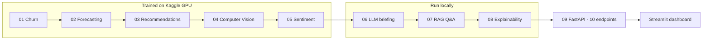

<div align="center">

# StreamIntel 360

**Eight machine learning and AI models for a streaming platform, connected through one API and one live dashboard.**

[](https://streamintel360-h5l8i2mdn5sfphbwsvcsyg.streamlit.app/)
[](https://www.python.org/)
[](https://www.tensorflow.org/)
[](https://fastapi.tiangolo.com/)
[](LICENSE)

[**Try the live demo**](https://streamintel360-h5l8i2mdn5sfphbwsvcsyg.streamlit.app/) · [Results](#results) · [How it fits together](#how-it-fits-together) · [Run it](#run-it-locally)

</div>

---

## What this is

A streaming service doesn't need one model, it needs several that share data and answer to the same team. I built StreamIntel 360 to practise exactly that: eight models covering churn, demand, recommendations, posters, reviews, reporting, Q&A and explainability, all saving their outputs in one agreed format so a single FastAPI backend (the ninth module) can serve any of them.

For every model I compared several algorithms and let a chosen metric pick the winner, instead of deciding up front. This was my capstone at the Boston Institute of Analytics and was graded 9/10.

## The modules

| # | Business question | What I built | Chosen model |
|---|---|---|---|
| 01 | Which subscribers are about to cancel? | Churn classifier (5 algorithms compared) | Logistic Regression |
| 02 | How much traffic will hit us next hour? | 24-hour sequence forecaster (RNN, LSTM, GRU, ARIMA/SARIMA) | LSTM |
| 03 | What should each user watch next? | Hybrid recommender: collaborative, content, popularity and SVD signals with tuned weights | Hybrid |
| 04 | Can we tag genres without manual work? | Multi-label genre classifier on poster images (4 CNNs compared) | EfficientNetB0 |
| 05 | How do viewers feel about titles? | Sentiment classifier on 50K IMDb reviews | Logistic Regression + TF-IDF |
| 06 | Can leadership get a readable summary? | Executive briefing written by an LLM from the verified metrics above | Gemini Flash Lite |
| 07 | Can anyone ask questions in plain English? | Retrieval-augmented Q&A over the project's own evidence | TF-IDF retrieval + Gemini |
| 08 | Why did a model decide that? | Feature contributions for churn; before/after view of the recommender's weights | Coefficient & weight analysis |
| 09 | How does an app use all of this? | FastAPI backend with 10 endpoints | — |

## Results

| Module | Metric | Result |
|---|---|---|
| Churn | F1 / ROC-AUC | 60.9% / 83.6% |
| Forecasting | RMSE / MAPE | 12,779 / 8.22% |
| Recommendations | MAP@10 / Hit rate@10 | 0.45% / 2.33% |
| Poster genres | Micro F1 (23 classes) | 52.8% |
| Sentiment | Accuracy / ROC-AUC | 91.1% / 97.0% |

A few things the numbers taught me:

- **Picking by one metric can fool you.** ResNet50V2 reached 97.8% recall on poster genres, but only because it predicted almost every genre for every poster (10.2% precision). EfficientNetB0 won on micro F1, which balances the two.
- **Tuning should change something, or it isn't worth reporting.** Grid search moved the recommender's collaborative weight from my default of 45% to 70%. Module 08 shows that difference directly.
- **I chose RMSE over MAE for forecasting on purpose.** RMSE punishes the rare big misses, and those are the ones that take a platform down.
- **Stopword lists can flip sentiment.** The standard ones remove "not" and "never", which turns "not good" into "good". I kept negations in.
- **Recommendation scores are low, and I've kept them visible.** MAP@10 of 0.45% is weak in absolute terms; sparse rating data makes this hard, and it's on the improvement list below.

## How it fits together



Every module writes to the same folder layout (`models/`, `preprocessors/`, `metrics/`, `metadata/`). That contract is what lets the API load any trained model without module-specific code, and it made moving models from Kaggle to my machine painless.

## Problems I had to solve along the way

- **A model that wouldn't unpickle.** The recommender was saved while running as `__main__`, so importing it elsewhere failed. I fixed it by registering the class under `__main__` before loading.
- **Deployment platform dead ends.** Hugging Face Spaces needed a paid tier for this setup, and Streamlit Cloud first forced a Python version my stack didn't support. I worked through both before landing a stable deployment.
- **A silent upload failure.** A `starlette` / `python-multipart` version mismatch broke the image upload endpoint without a clear error.

## Tech stack

| Area | Tools |
|---|---|
| Machine learning | scikit-learn, XGBoost, TensorFlow / Keras |
| NLP and LLMs | TF-IDF, Google Gemini |
| Backend | FastAPI |
| Frontend | Streamlit, Plotly |
| Training | Kaggle GPU |
| Hosting and versioning | Streamlit Community Cloud, Git LFS for model files |

## Run it locally

```bash
git clone https://github.com/hamazmubashar/streamintel360.git
cd streamintel360
pip install -r requirements.txt
```

Add a `.env` file with `GEMINI_API_KEY=your_key_here` (only the LLM and Q&A modules need it), then:

```bash
streamlit run streamlit_app_v2.py      # dashboard
uvicorn app_main:app --reload          # API on its own, docs at http://127.0.0.1:8000/docs
```

## Project structure

```
streamintel360/
├── app_main.py            # FastAPI backend, 10 endpoints
├── streamlit_app_v2.py    # dashboard
├── requirements.txt
├── runtime.txt
├── artifacts/             # trained models, preprocessors and metrics (Git LFS)
└── notebooks/             # the 9 notebooks, from churn to the integration API
```

## What I'd improve next

- Raise churn recall (57.5% today) with threshold tuning or cost-sensitive training
- Better recommendation quality, starting with implicit-feedback models
- Feed the forecaster live features instead of batch-built ones
- Extend explanations to the vision and sentiment models
- Add CI to retrain and re-evaluate automatically

## Author

**Hamaz Mubashar** · [LinkedIn](https://www.linkedin.com/in/hamazmubashar) · [GitHub](https://github.com/hamazmubashar) · hamazmubashar2@gmail.com

Released under the [MIT License](LICENSE).
